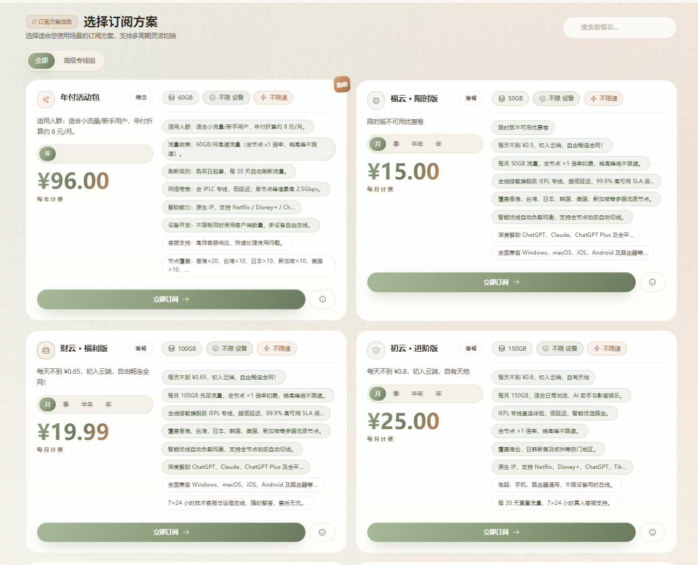
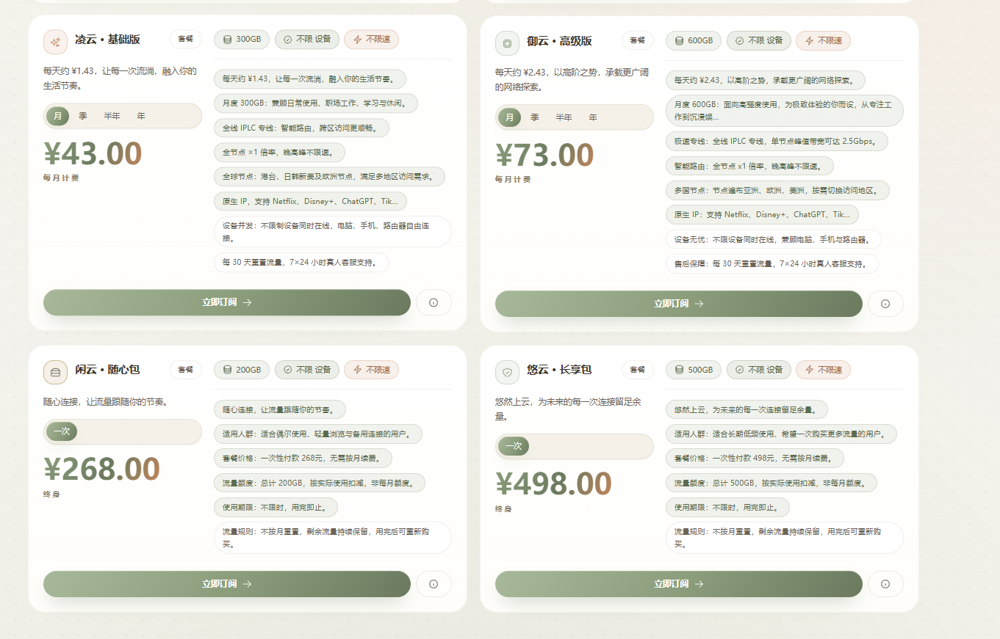
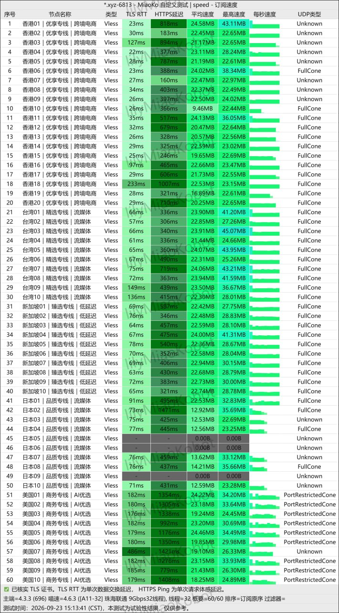
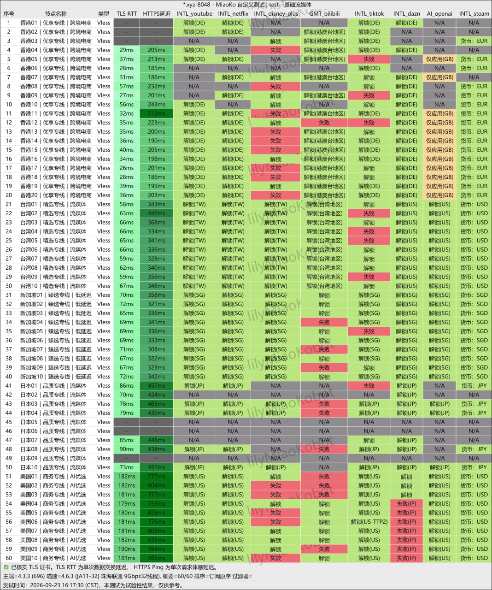

大佬云本次收录资料包含五档月付、一档年付和两档一次性不限时流量包。**截图所列最低月付是15元50GB；年付活动包为96元/年、60GB/月，折合8元/月，需要一次支付96元。**

本文依据2026年11月5日收到的用户投稿、套餐截图和两张历史测试图整理。尚无本站独立实测，也未登录后台核价或实际购买；截图中的套餐是否仍在售、最终实付及退款规则，请以下单页为准。新收录不赋予销量排名，收录不表示各项推荐标准已全部独立核实。

<!-- more -->

## 大佬云入口与基础信息

<AffiliateLink href="https://ermaozi.dalaoyunaff.com/#/?code=sEyr5n3v">大佬云入口（含推广参数）</AffiliateLink>

通过此链接注册或购买，本站可能获得佣金。推广关系不改变事实核验与风险提示，详见[推广披露](/affiliate-disclosure/)。

| 项目 | 投稿说明与核验状态 |
| --- | --- |
| 起运营日 | 投稿称2023年6月8日起运营，未独立核实持续运营记录 |
| 付款方式 | 投稿称支付宝、微信、USDT；当前支付渠道与币种以下单页为准 |
| 通用订阅 | 投稿称不支持；购买前确认具体订阅格式及客户端兼容性 |
| Telegram | 投稿提供 [@shandianjiaoliu](https://t.me/shandianjiaoliu)，归属及活跃度未核实 |
| 不限时套餐 | 新套餐截图列有200GB、500GB两档，替代原文字投稿中的“无” |
| 官网与工单 | 本次公开入口核验仅到登录/注册页，未进入订单、工单或售后流程 |
| 本站测试 | 无独立速度、解锁、晚高峰或客服响应测试 |

## 套餐价格与重置规则

以下金额来自**2026年11月5日用户提供的套餐截图**。截图显示“¥”，本文按人民币记录；未独立核对结算币种。套餐名称及额度保留截图记录，不使用未确认的折扣价。

### 月付与年付套餐

| 套餐 | 价格 | 流量 | 计费周期 | 规则 |
| --- | --- | --- | --- | --- |
| 年付活动包 | ¥96/年 | 60GB/月 | 年付，一次支付96元 | 购买日起每30天刷新流量，折合8元/月 |
| 福云·限时版 | ¥15/月 | 50GB/月 | 月付 | 限时版不可用优惠券；具体重置日待确认 |
| 财云·福利版 | ¥19.99/月 | 100GB/月 | 月付 | 截图标注每月100GB，具体重置日待确认 |
| 初云·进阶版 | ¥25/月 | 150GB/月 | 月付 | 每30天重置流量 |
| 凌云·基础版 | ¥43/月 | 300GB/月 | 月付 | 每30天重置流量 |
| 御云·高级版 | ¥73/月 | 600GB/月 | 月付 | 每30天重置流量 |

年付活动包的“8元/月”仅是96元除以12的月均费用，不能按8元单月购买。每30天重置也不能自动理解为每个自然月1日重置。截图中15元、19.99元档另有更长周期选项，但未提供相应金额，本文不推算。

### 一次性不限时流量包

| 套餐 | 价格 | 流量 | 计费周期 | 规则 |
| --- | --- | --- | --- | --- |
| 闲云·随心包 | ¥268/次 | 200GB | 一次性，不限时 | 总量200GB，不按月重置，剩余保留，用完即止 |
| 悠云·长享包 | ¥498/次 | 500GB | 一次性，不限时 | 总量500GB，不按月重置，剩余保留，用完即止 |

“不限时”来自商家套餐说明，表示所购流量按总量消耗，不代表无限流量或服务永久运营。原文字投稿只列六档价格且写“无一次性”，此处以随后补充的具体套餐截图修正。19.99元档按本次截图记录100GB，不沿用其他旧资料中的120GB。

### 投稿套餐原图

以下两图为投稿人提供的套餐画面，接收日期为2026年11月5日，不是本站登录后台拍摄的截图。图中的线路、带宽、解锁及售后文案均为商家宣传。

## 线路、协议与售后说法

商家投稿宣称使用VLESS协议、海外大机房专线及港、台、日、新、美等60多个节点，并宣传Netflix、Disney+、ChatGPT、Claude等平台访问能力。套餐图另有IPLC、IEPL、1倍流量、不限设备和不限速等表述；这些标签不是本站验证过的线路或性能结论。

投稿还称提供24小时在线售后，线路故障1小时内恢复。本站未验证工单通道、响应时效或修复记录，不能把这些承诺作为本站保证。大陆官网可访问性、用户群活跃度、稳定性、纠纷情况及长期运营连续性仍需后续核实。

## 历史测速与解锁截图

### 2026年9月23日测速图

图中时间为**2026-09-23 15:13:41（CST）**，标注珠海联通9Gbps、32线程；列出60条Vless节点：香港20条，台湾、新加坡、日本、美国各10条。日本05、06、09显示零速。图中“60/60”是排序记录数量，不能理解为60条都测速成功。

这是用户提供的历史测试图，本站没有运行该测试。其日期早于本文收录，时段也不是本站评测方法中的20:00–23:00晚高峰；缺少普通用户本地网络、设备、客户端及多时段重复记录，不能推出当前速度、晚高峰百兆跑满或长期稳定。

### 2026年9月23日解锁图

图中时间为**2026-09-23 16:17:30（CST）**。画面包含红色失败及N/A结果，部分OpenAI记录为“仅应用”或“失败(IP)”；香港部分YouTube、Netflix结果标为DE，不能仅凭节点名称判断解锁地区。图中没有Claude测试列。

商家“全绿原生解锁”的宣传与这张历史截图不完全一致。截图不能证明当前所有节点、所有平台均可用，也不能支持Claude全部解锁或所有地区原生解锁的结论。具体服务和账号条件应在自己的网络中验证，参见[机场评测方法](/review-methodology/)。

## 购买前核对

- 将15元月付50GB与96元年付60GB/月分开比较，确认实际支付总额、币种、流量重置日和有效期。
- 需要优惠券时先确认适用范围；福云·限时版截图明确不支持优惠券。
- 投稿称不支持通用订阅，先确认你的客户端能否导入实际订阅，不能仅凭VLESS标签推断兼容。
- 确认试用、退款、设备限制、工单入口和服务条款；这些信息尚未完整提供。
- 先选择可承受损失的小额短周期方案，在常用网络测试目标平台和晚高峰表现，再决定是否续费。

## 常见问题

### 大佬云最低是8元月付吗？

不是。投稿截图中最低月付为15元50GB；8元是96元年付的月均折算，年付档为60GB/月、购买日起每30天刷新，需要一次付96元。

### 大佬云有不限时套餐吗？

补充截图列有268元200GB和498元500GB两档一次性包，总量消耗、不按月重置、剩余保留，用完即止；替代原文字投稿的“无”。

### 支持通用订阅和哪些付款方式？

投稿称不支持通用订阅，付款方式为支付宝、微信、USDT。本站没有独立验证后台订阅格式或结算渠道，购买前应自行确认。

### 测速和解锁是本站实测吗？

不是。两张图均为2026年9月23日的投稿历史材料，有零速、失败、N/A及地区差异记录；没有本站独立测试，也没有Claude测试列。

## 相关入口与教程

- [机场资料与套餐汇总](/posts/vpn/)
- [热门机场速览](/airport/)
- [机场选购指南](/article/choose-good-airport/)
- [Windows客户端教程](/article/0gematwc/) · [Android客户端教程](/article/eh8f4n86/)
- [iOS Shadowrocket教程](/article/z747kgjd/) · [macOS客户端教程](/article/6vxkmmuh/)

教程仅说明客户端使用方式，不表示大佬云已验证兼容这些客户端。欢迎通过[更正入口](/corrections/)补充可复查的套餐与测试资料。
