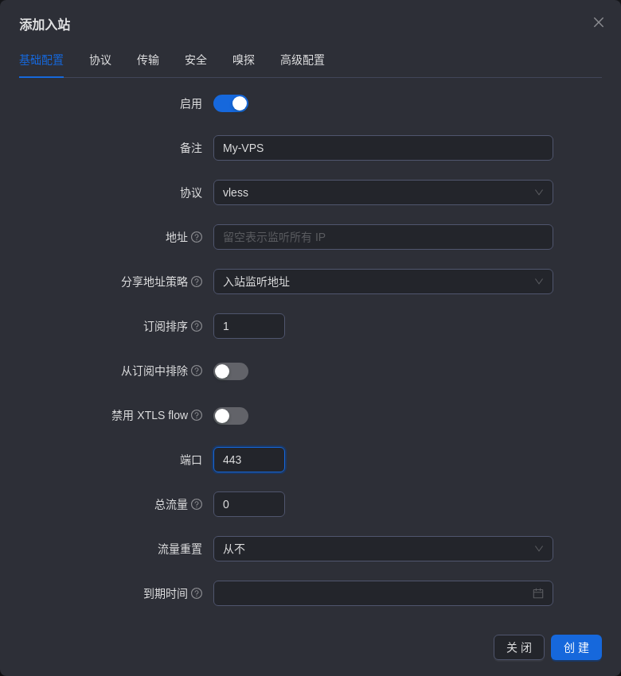
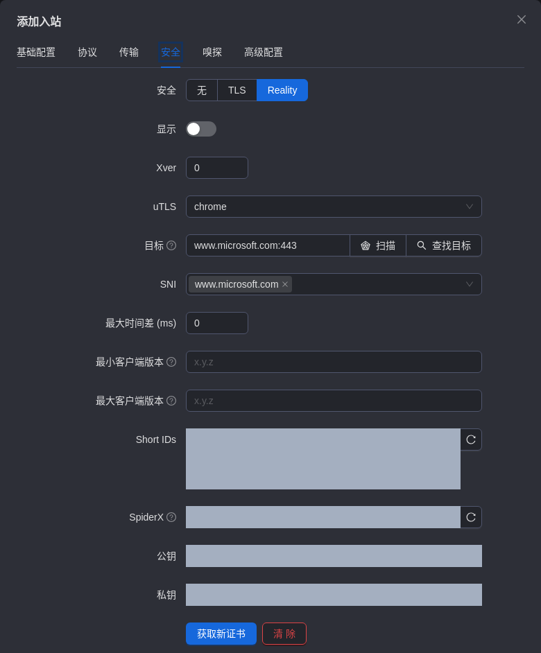
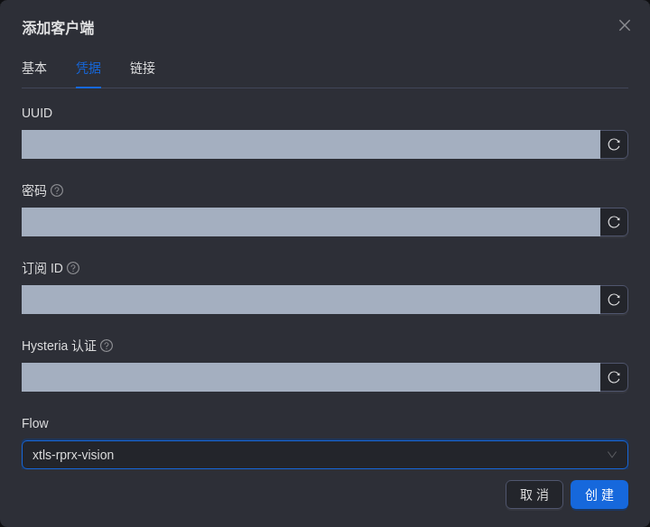

有一台能从外网连到的 Ubuntu 24.04 VPS，就可以按本文搭建一个自用的 VLESS + REALITY 节点。服务器用 3x-ui 管理 Xray，节点走 TCP 443；管理面板通过 SSH 隧道访问，不向公网开放。按这套配置，不用购买自己的域名，也不用给服务器申请证书。

<!-- more -->

## 一、准备服务器和端口

| 项目 | 本文设置 | 你需要准备什么 |
| --- | --- | --- |
| VPS | Ubuntu 24.04 LTS，已有公网 IPv4 | 从云控制台复制公网 IP，确认有这台服务器的管理权限 |
| SSH | 示例使用 TCP 22 | 实际登录账号、SSH 密钥或密码；账号应能运行 `sudo` |
| 节点 | TCP 443 | 服务器没有网站或其他服务占用此端口 |
| 面板 | VPS 的 `127.0.0.1:2053` | 不在云安全组开放 2053；本地用 18053 转发 |
| 客户端 | v2rayN、Shadowrocket 或 v2rayNG | 按设备选一个，第一次搭建建议先用 v2rayN 验证 |

下文的 `203.0.113.10` 是示例地址，不能直接连接。把它换成你的 VPS 公网 IP，把 `ubuntu` 换成实际的 SSH 用户名。如果 SSH 不是 22 端口，把 `-p 22` 改成实际端口；云厂商要求指定密钥时，加上 `-i` 和本地私钥文件路径。

**在本地电脑的终端执行：**

```bash
ssh -p 22 ubuntu@203.0.113.10
```

如果首次连接提示核对主机指纹，可在云控制台的服务器终端执行 `sudo ssh-keygen -lf /etc/ssh/ssh_host_ed25519_key.pub`，与 SSH 提示中的 ED25519 指纹对照。若两边显示的算法不同，先核对同一算法的指纹。

**登录 VPS 后执行：**

```bash
. /etc/os-release
printf '%s\n' "$PRETTY_NAME"
sudo -v
sudo ss -lntp '( sport = :443 or sport = :2053 )'
sudo ufw status verbose
```

应看到 Ubuntu 24.04，`sudo -v` 无报错。端口检查若只有表头，说明这两个 TCP 端口当前没有进程监听。443 已被网站占用时，不要停掉现有服务；用另一台 VPS 走本文流程。已经有 3x-ui、复杂防火墙或自定义网络的机器，也不要直接套用下面的首次安装步骤。

在云控制台保留原有的 SSH 入站规则，新增 **TCP 443**。家里有固定出口 IP 时，可以把来源限制为自己的 IP；需要从不同网络连接时，再按需要放宽来源。**不要开放 TCP 2053 或 2096。** 如果安全组已有「放通所有端口」的规则，先调整规则并用第二个终端确认 SSH 仍能登录，不要关掉原 SSH 窗口。

## 二、安装 3x-ui 并登录面板

3x-ui 是管理面板，真正处理代理连接的是它启动的 Xray。本文以 [3x-ui v3.11.0](https://github.com/MHSanaei/3x-ui/releases/tag/v3.11.0) 的安装交互和字段为例。以后使用新版本时，先核对 [官方发布页](https://github.com/MHSanaei/3x-ui/releases) 和对应版本的安装说明，尤其是防火墙和面板监听的提示。

**在 VPS 执行：**

```bash
sudo apt-get update
sudo apt-get install -y ca-certificates curl openssl
curl --fail --location --show-error --silent \
  'https://raw.githubusercontent.com/MHSanaei/3x-ui/v3.11.0/install.sh' \
  -o "$HOME/3x-ui-v3.11.0-install.sh"
bash -n "$HOME/3x-ui-v3.11.0-install.sh"
```

`bash -n` 没有输出，只表示脚本语法通过，不代表已经安装。也可以先用 `less "$HOME/3x-ui-v3.11.0-install.sh"` 看脚本。下载失败就不要执行下一条命令。

```bash
sudo env XUI_ENABLE_FAIL2BAN=false bash "$HOME/3x-ui-v3.11.0-install.sh" v3.11.0
```

请在正常 SSH 终端中运行，不要把安装命令接到管道后面。按下面的项目回答安装提示：

| 安装提示 | 本文选项 |
| --- | --- |
| 数据库 | SQLite |
| 是否自定义面板端口 | 输入 `y`，端口填 `2053` |
| SSL Certificate Setup | 选择 `4`，即跳过面板证书 |
| 是否只绑定 `127.0.0.1` | 输入 `y`，不要直接按回车 |

这一步跳过的是**管理面板**的 HTTPS。浏览器访问本机，浏览器到 VPS 的跨网段流量由 SSH 加密；不需要为此开放 80 端口。安装命令让脚本跳过 Fail2ban 的自动设置，不会关闭你现有的防护。安装结束后保存面板用户名、密码和 `WebBasePath`。安装结果还可能显示 API Token，不要把这一屏截图发给别人。

**仍在 VPS 检查：**

```bash
sudo systemctl is-active x-ui
sudo systemctl is-enabled x-ui
sudo ss -lntp '( sport = :2053 )'
```

前两条应输出 `active` 和 `enabled`，面板应监听 `127.0.0.1:2053`，而不是 `0.0.0.0:2053` 或 `[::]:2053`。若误选了公网监听，保持云安全组不放行面板，并执行：

```bash
sudo /usr/local/x-ui/x-ui setting -listenIP 127.0.0.1
sudo systemctl restart x-ui
sudo ss -lntp '( sport = :2053 )'
```

**在本地电脑另开一个终端，不是在 VPS 上执行：**

```bash
ssh -p 22 -N -o ExitOnForwardFailure=yes \
  -L 127.0.0.1:18053:127.0.0.1:2053 ubuntu@203.0.113.10
```

这条命令成功后通常不打印内容，终端也不会返回提示符。保持窗口打开，浏览器访问 `http://127.0.0.1:18053/实际路径/`。例如安装结果里的路径是 `/a1b2c3d4/`，本地地址就是 `http://127.0.0.1:18053/a1b2c3d4/`。若不记得路径，在 VPS 执行 `sudo /usr/local/x-ui/x-ui setting -show`，找 `webBasePath`。

登录后，如果只用单节点链接，可在面板的订阅设置里关闭订阅服务并保存；本文不需要开放订阅端口。检查时用 `sudo ss -lntp '( sport = :2096 )'`，如果订阅服务已关闭且没有其他程序占用，该端口不会监听。

## 三、在面板创建 VLESS + REALITY 节点

在左侧点 **入站 → 添加入站**。在「基础配置」填写备注、协议和端口；「传输」选择 RAW；最后到「安全」选择 Reality。VLESS 使用 UUID 区分客户端；REALITY 负责保护连接握手。设备连的是你的 VPS 公网 IP，设置中的 Target、SNI 和设备要访问的网站是不同的东西。



| 面板字段 | 填写方式 |
| --- | --- |
| 启用、备注 | 启用；备注可填 `My-VPS` |
| 协议（Protocol） | `vless` |
| 地址（监听 IP） | 留空，使用默认监听；别填 `127.0.0.1`，否则外部设备连不到节点 |
| 端口（Port） | `443` |
| 传输 | `RAW`（TCP），不用 WebSocket、gRPC 或 HTTP 伪装头 |
| 安全（Security） | `reality` |
| 目标（Target，旧版也叫 Dest） | 例如 `www.microsoft.com:443`，以 VPS 实际检测结果为准 |
| SNI / Server Names | `www.microsoft.com`，不加 `https://`、端口或路径；输入后按回车添加 |
| Public / Private Key | 使用该栏下的「获取新证书」生成 REALITY 密钥对；这里不是给 VPS 申请网站证书。私钥留在服务端，配到客户端的是公钥 |
| Short IDs | 面板会预填；不用照抄截图。客户端使用其中一个对应值 |
| Fingerprint（如界面显示） | `chrome` |
| 其他 | 不额外启用 PROXY protocol、XHTTP、后量子校验或其他附加选项 |



Target 应能从 VPS 连通，并支持 TLS 1.3 和 HTTP/2。填写前在 VPS 检查。以下命令最多运行 12 秒，输出里应看到 `TLSv1.3` 或 `TLS 1.3`、`ALPN protocol: h2`，以及证书校验成功。官方文档用微软站点举例，可用性取决于你的 VPS；不要在检测不通过时照填。换 Target 时，同步替换这里的主机名、面板中的 SNI，以及客户端配置对应字段。

```bash
timeout 12s openssl s_client -connect www.microsoft.com:443 \
  -servername www.microsoft.com -verify_hostname www.microsoft.com \
  -verify_return_error -tls1_3 -alpn h2 </dev/null 2>&1 \
  | grep -E 'TLSv1\.3|TLS 1\.3|ALPN protocol|Verify return code|Verification:'
```

如果面板未能生成密钥或 Short ID，在 VPS 可用以下命令。第一条按实际架构选中随 3x-ui 安装的 Xray，第二条生成一个 16 位十六进制 Short ID：

```bash
XRAY_BIN="$(sudo find /usr/local/x-ui/bin -maxdepth 1 -type f -name 'xray-linux-*' -print -quit)"
if [ -n "$XRAY_BIN" ]; then sudo "$XRAY_BIN" x25519; fi
openssl rand -hex 8
```

新版 Xray 的输出里，`PrivateKey` 是服务端私钥，`Password (PublicKey)` 是客户端公钥，仍对应分享链接里的 `pbk`。不用填 `Hash32`。不要把命令输出整段贴到帖子、工单或截图里。

点击「创建」保存入站。**v3.11.0 里客户端要单独添加：** 左侧点「客户端 → 添加客户端」，在「基本」的「关联入站」选择刚建的 `My-VPS`，再到「凭据」保留自动生成的 UUID，Flow 选 `xtls-rprx-vision`，点击「创建」。



在 VPS 检查服务监听。如果 UFW 已经启用，且你确实要允许所有来源访问节点，可执行第二段命令；如果只在固定公网 IP 下用，将放行命令替换为 `sudo ufw allow from 198.51.100.24 to any port 443 proto tcp comment 'VLESS REALITY'`（把示例来源改成你的实际 IP）。**UFW 未启用时不为本文临时启用它**，仍然用云安全组控制公网入站。

```bash
sudo ss -lntp '( sport = :443 )'
sudo journalctl -u x-ui -n 40 --no-pager
```

```bash
sudo ufw allow 443/tcp comment 'VLESS REALITY'
sudo ufw status numbered
```

如果服务器还有 nftables、云防火墙或其他规则，须在实际生效的防火墙检查 443，别为了排错把防火墙整个关掉。服务端 443 有监听，只说明节点进程起来了，还没说明客户端已经连通。

## 四、把节点导入手机或电脑

在「客户端」列表里点对应行的「二维码」。弹窗可能先显示「订阅信息」；选择标有 **Vless / TCP / REALITY** 的那一项，再复制 `vless://` 单节点链接或扫码。**先核对链接的服务器地址是 VPS 公网 IP，端口是 443。** 如果面板生成的是 `127.0.0.1`，那是因为你通过 SSH 隧道访问面板；在客户端编辑该节点的服务器地址，改成 VPS 公网 IP。不要把本地转发端口 18053 或面板端口 2053 填进去。

### Windows：v2rayN

从 [v2rayN 官方发布页](https://github.com/2dust/v2rayN/releases) 安装客户端。复制节点链接，在主窗口按 `Ctrl+V`（也可从服务器菜单选择从剪贴板导入），选中这条服务器并设为活动服务器。打开「自动配置系统代理」，用浏览器访问网页验证。部分程序不读系统代理，测试时优先用下文的显式代理命令。

### iPhone / iPad：Shadowrocket（小火箭）

安装方式见[小火箭下载安装教程](https://www.ermao.net/article/z747kgjd/)。同一台手机里复制节点链接后，可打开小火箭按提示导入剪贴板；面板在电脑上时，也可用小火箭里的扫码入口扫描客户端二维码。选择新节点，打开连接开关；首次弹出添加 VPN 配置的系统提示时确认。若要对比公网 IP，测试时将「全局路由」临时切到「代理」，测完再改回你的日常规则。

### Android：v2rayNG

从 [v2rayNG 官方发布页](https://github.com/2dust/v2rayNG/releases) 下载对应架构的 APK；不确定架构且该版本提供 universal 包时，可以选 universal。复制分享链接后，在应用右上角点「+」，选从剪贴板导入；也可选择扫描二维码。选中节点并点右下角启动，按系统提示授权 VPN。

### Clash / Mihomo：导入 YAML 配置

`vless://` 是单节点分享链接，不是 Clash/Mihomo 的 YAML 订阅地址。使用支持 VLESS + REALITY 的 Mihomo 客户端时，可以在本地新建 YAML，把下面几处占位值改成你的节点参数，再导入配置文件。UUID、公钥和 Short ID 直接取自面板或原链接，不需要上传到在线转换站。[Mihomo VLESS 配置文档](https://wiki.metacubex.one/config/proxies/vless/)

```yaml
mixed-port: 7890
allow-lan: false
mode: rule

proxies:
  - name: "My-VPS"
    type: vless
    server: 203.0.113.10
    port: 443
    uuid: "换成客户端UUID"
    network: tcp
    tls: true
    flow: xtls-rprx-vision
    servername: "www.microsoft.com"
    client-fingerprint: chrome
    reality-opts:
      public-key: "换成REALITY公钥"
      short-id: "换成面板生成的ShortID"

proxy-groups:
  - name: "VPS"
    type: select
    proxies:
      - "My-VPS"

rules:
  - MATCH,VPS
```

这份最小配置把**交给客户端处理的**流量发往 VPS。导入后仍需开启相应的系统代理或 TUN 功能；如果已有日常规则，用单独的测试配置，不要直接覆盖。若 v2rayN 能连、Mihomo 却失败，先看客户端实际捆绑的内核及服务端的最低客户端版本设置，不要用关闭证书验证来排错。[3x-ui 的 REALITY 配置说明](https://github.com/MHSanaei/3x-ui/blob/v3.11.0/docs/content/docs/en/config/reality.mdx)

## 五、验证连接与公网出口

先在 VPS 查询本机的 IPv4 出口。再在客户端测试经由节点的出口；两次应返回相同的 IPv4。若服务商单独配置了出站 NAT，以这条命令返回的 VPS **出站 IP** 为准，不要强求它等于 SSH 的入站 IP。下面的查询会向 IP 查询站发送请求。

**在 VPS：**

```bash
curl -4fsS --noproxy '*' --max-time 15 https://api.ipify.org
```

**在本地电脑：** 下例是 Windows PowerShell。先得到直连 IP，再把 `10808` 换成 v2rayN 界面显示的本地 SOCKS 或混合代理端口。若用上面的 Mihomo 配置，把端口改成 `7890`。两条命令可分别执行。

```powershell
curl.exe -4fsS --noproxy "*" --max-time 15 https://api.ipify.org
curl.exe -4fsS --noproxy "unused.invalid" --proxy socks5h://127.0.0.1:10808 --max-time 15 https://api.ipify.org
```

`socks5h` 让这个请求的域名交给代理侧解析。手机不必装终端：关闭代理时先用浏览器打开同一地址记下结果，打开代理并切到全局代理模式后重新打开。需要让普通浏览器走系统代理时，最后用浏览器再测一次。**客户端有延迟数字不等于你的浏览器已经通过节点出网。**

关闭面板的 SSH 隧道，客户端应仍能使用节点。再重启 3x-ui 服务并复测一次，确认入站配置已保存。服务重启会让节点短暂掉线：

```bash
sudo systemctl restart x-ui
sudo systemctl is-active x-ui
sudo ss -lntp '( sport = :443 )'
```

## 六、常见故障

| 症状 | 先检查什么 |
| --- | --- |
| 面板打不开 | VPS 先运行 `sudo systemctl is-active x-ui`。确认 VPS 面板实际绑定 `127.0.0.1:2053`，本地 SSH 转发窗口没关，以及浏览器地址包含正确的 `WebBasePath`。本地 18053 已占用，就换一个本地端口。 |
| 节点连接超时 | VPS 用 `sudo ss -lntp '( sport = :443 )'` 确认监听；核对云安全组、UFW、目标 IP 和端口。从 Windows 本地用 `Test-NetConnection 203.0.113.10 -Port 443` 排查 TCP 连通性；成功不等于 REALITY 握手成功。 |
| TCP 能通，握手却失败 | 对照 UUID、Flow、SNI、公钥和 Short ID；确认选的是 TCP (RAW) + REALITY，再检查 Target 和客户端内核。VPS 用 `sudo journalctl -u x-ui -n 60 --no-pager` 查服务异常。 |
| 客户端显示已连，公网 IP 还是旧的 | 先用显式 SOCKS 请求验证，再查应用有没有使用系统代理，以及规则是否把查询站送去直连。 |
| 保存后 443 不监听 | 查入站是否启用、是否被其他进程占用、日志是否提示配置错误。不要先杀掉监听 443 的其他服务。 |

## 七、备份、撤销设备与停用

设备多了，在同一个入站下给每台设备分配各自的 UUID，用备注区分。设备丢失或分享链接泄露时，删除或禁用对应客户端，保存后用另一台设备确认其连接不受影响。链接和二维码相当于节点凭据。

升级前在面板下载 SQLite 数据库备份，记下 3x-ui 和 Xray 版本。备份含节点凭据，放在只有管理员可读的位置。如果不再使用这套节点，可先在面板禁用入站；不再需要 3x-ui 时，在 VPS 停用服务：

```bash
sudo systemctl disable --now x-ui
sudo ss -lntp '( sport = :443 or sport = :2053 or sport = :2096 )'
```

到云控制台撤销此次给节点新增的 TCP 443 规则。若曾添加本文的 UFW 规则，先用 `sudo ufw status numbered` 找到带 `VLESS REALITY` 注释的对应编号，再执行 `sudo ufw delete 编号`，把「编号」换成实际数字。其他网站或服务已有的 443 规则不要删。最后另开终端验证 SSH。

## 常见问题

### 自建节点一定要域名吗？

本文用 VPS 的公网 IP 连接，**不需要自己购买域名**。REALITY 配置仍有 Target 和 SNI，它们不是给你的 VPS 做域名解析。

### 自建一个节点就有订阅链接吗？

本文导出的是一个 `vless://` 节点链接，不是会随着服务端更新而刷新的订阅。只管理少量设备，单节点链接或本地 YAML 已经够用。

### BBR 要现在开吗？

不是搭建的必要条件。先完成连接和出口测试，有实际的延迟、丢包或吞吐问题时再单独排查。

电脑和手机客户端也可对照站内的[Clash Mi 使用教程](https://www.ermao.net/blog/clashmi/)和[小火箭使用教程](https://www.ermao.net/article/z747kgjd/)。

参考：[3x-ui 官方安装与发布](https://github.com/MHSanaei/3x-ui) · [3x-ui v3.11.0 安装脚本](https://github.com/MHSanaei/3x-ui/blob/v3.11.0/install.sh) · [Xray 官方文档](https://xtls.github.io/) · [Mihomo VLESS 字段说明](https://wiki.metacubex.one/config/proxies/vless/)

搭建时遇到问题，或者有更好的做法，欢迎在评论区留言。我看到后会回复。
